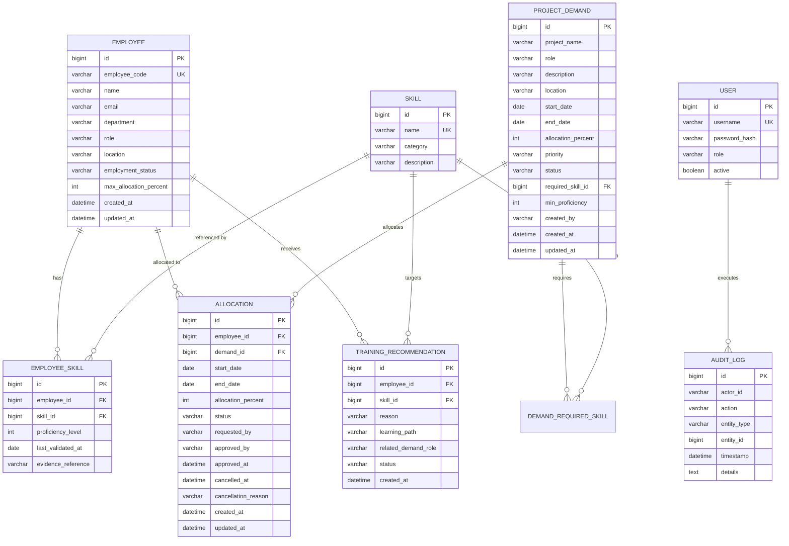

# Database Design: AI-Driven Talent and Resource Allocation Marketplace

## 1. Schema Overview & Relational Architecture
The database schema is normalized to **Third Normal Form (3NF)** with strict referential integrity, foreign key cascades, and unique constraints preventing duplication.

---

## 2. Entity-Relationship Diagram (Mermaid)

---

## 3. Data Dictionary & Table Definitions

### 3.1 `employees`
| Column | Type | Constraints | Description |
|---|---|---|---|
| `id` | BIGINT | PRIMARY KEY, AUTO_INCREMENT | Unique identifier |
| `employee_code` | VARCHAR(30) | UNIQUE, NOT NULL | Enterprise employee code (e.g. EMP001) |
| `name` | VARCHAR(100) | NOT NULL | Full employee name |
| `email` | VARCHAR(100) | NOT NULL | Corporate email address |
| `department` | VARCHAR(50) | NOT NULL | Organizational department |
| `role` | VARCHAR(50) | NOT NULL | Primary professional job title |
| `location` | VARCHAR(50) | NOT NULL | Base geographic location (e.g. New York) |
| `employment_status` | VARCHAR(20) | NOT NULL | `ACTIVE`, `ON_LEAVE`, `TERMINATED` |
| `max_allocation_percent` | INT | NOT NULL, DEFAULT 100 | Configured maximum capacity (1–100) |
| `created_at` | TIMESTAMP | NOT NULL | Record creation timestamp |
| `updated_at` | TIMESTAMP | NULL | Record update timestamp |

### 3.2 `skills`
| Column | Type | Constraints | Description |
|---|---|---|---|
| `id` | BIGINT | PRIMARY KEY, AUTO_INCREMENT | Unique identifier |
| `name` | VARCHAR(100) | UNIQUE, NOT NULL | Name of technology/competency |
| `category` | VARCHAR(50) | NOT NULL | Category (Programming, Cloud, AI/ML, etc.) |
| `description` | VARCHAR(255) | NULL | Skill overview and domain scope |

### 3.3 `employee_skills`
| Column | Type | Constraints | Description |
|---|---|---|---|
| `id` | BIGINT | PRIMARY KEY, AUTO_INCREMENT | Unique record ID |
| `employee_id` | BIGINT | FK -> employees(id), NOT NULL | Foreign key to employee |
| `skill_id` | BIGINT | FK -> skills(id), NOT NULL | Foreign key to skill |
| `proficiency_level` | INT | NOT NULL, CHECK (1..5) | 1=Beginner, 2=Intermediate, 3=Advanced, 4=Expert, 5=Master |
| `last_validated_at` | DATE | NULL | Date of verification/certification |
| `evidence_reference` | VARCHAR(255) | NULL | Certification/Project evidence string |

### 3.4 `project_demands`
| Column | Type | Constraints | Description |
|---|---|---|---|
| `id` | BIGINT | PRIMARY KEY, AUTO_INCREMENT | Unique demand ID |
| `project_name` | VARCHAR(100) | NOT NULL | Project title |
| `role` | VARCHAR(100) | NOT NULL | Role required (e.g. Java Tech Lead) |
| `description` | TEXT | NULL | Project scope & requirements |
| `location` | VARCHAR(50) | NOT NULL | Required location or 'Remote' |
| `start_date` | DATE | NOT NULL | Demand start date |
| `end_date` | DATE | NOT NULL | Demand end date |
| `allocation_percent` | INT | NOT NULL, CHECK (1..100) | Capacity requested % |
| `priority` | VARCHAR(20) | NOT NULL | `LOW`, `MEDIUM`, `HIGH`, `CRITICAL` |
| `status` | VARCHAR(20) | NOT NULL | `OPEN`, `IN_PROGRESS`, `FULFILLED`, `CANCELLED` |
| `required_skill_id` | BIGINT | FK -> skills(id), NULL | Primary mandatory skill |
| `min_proficiency` | INT | DEFAULT 1 | Minimum required skill rating |

### 3.5 `allocations`
| Column | Type | Constraints | Description |
|---|---|---|---|
| `id` | BIGINT | PRIMARY KEY, AUTO_INCREMENT | Unique allocation ID |
| `employee_id` | BIGINT | FK -> employees(id), NOT NULL | Allocated employee |
| `demand_id` | BIGINT | FK -> project_demands(id), NOT NULL | Target project demand |
| `start_date` | DATE | NOT NULL | Allocation start date |
| `end_date` | DATE | NOT NULL | Allocation end date |
| `allocation_percent` | INT | NOT NULL, CHECK (1..100) | Committed workload % |
| `status` | VARCHAR(20) | NOT NULL | `REQUESTED`, `CONFIRMED`, `CANCELLED` |
| `requested_by` | VARCHAR(100) | NULL | Actor requesting allocation |
| `approved_by` | VARCHAR(100) | NOT NULL | Mandatory approver identity |
| `approved_at` | TIMESTAMP | NOT NULL | Timestamp of confirmation |
| `cancelled_at` | TIMESTAMP | NULL | Timestamp if cancelled |
| `cancellation_reason`| VARCHAR(255) | NULL | Logged reason for cancellation |

### 3.6 `training_recommendations`
| Column | Type | Constraints | Description |
|---|---|---|---|
| `id` | BIGINT | PRIMARY KEY, AUTO_INCREMENT | Unique recommendation ID |
| `employee_id` | BIGINT | FK -> employees(id), NOT NULL | Target employee requiring upskilling |
| `skill_id` | BIGINT | FK -> skills(id), NOT NULL | Skill recommended for development |
| `reason` | VARCHAR(1000) | NOT NULL | Rationale for recommendation / skill gap |
| `learning_path` | VARCHAR(1000) | NULL | Suggested certification or course path |
| `related_demand_role` | VARCHAR(200) | NULL | Target demand role motivating training |
| `status` | VARCHAR(20) | NOT NULL | `RECOMMENDED`, `IN_PROGRESS`, `COMPLETED`, `REJECTED` |
| `created_at` | TIMESTAMP | NOT NULL | Timestamp when recommendation generated |

---

## 4. Database Indexes for Performance
1. `idx_alloc_emp_dates` ON `allocations(employee_id, start_date, end_date, status)` — Accelerates capacity queries.
2. `idx_emp_skills_emp_id` ON `employee_skills(employee_id, skill_id)` — Optimizes skill matching.
3. `idx_demand_status` ON `project_demands(status, priority)` — Powers dashboard metrics.
